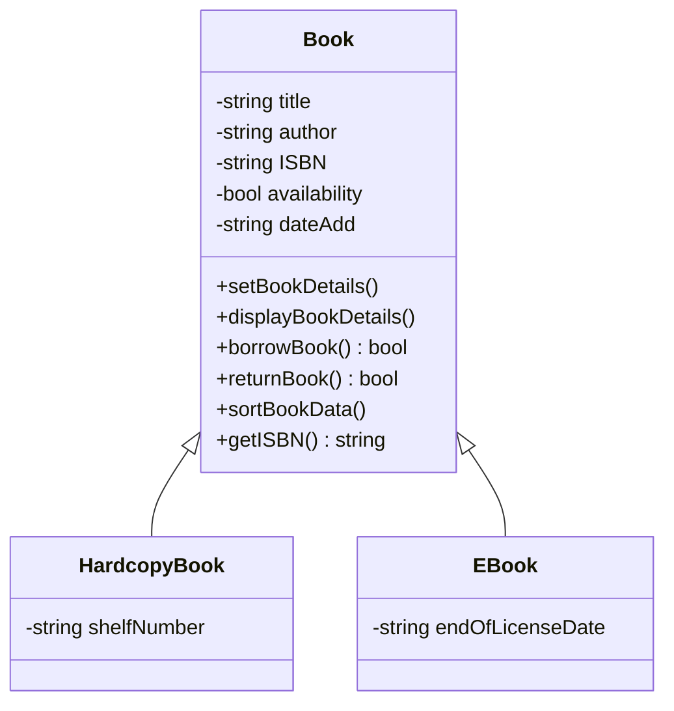

# Phase 2 Design

This document updates the library design for phase 2.
The current C++ program is not changed yet. This file only describes the new design.

The library will manage two types of books:

- a hardcopy book, which sits on a shelf
- an e-book, which has a licence end date

Both types are still books. They share the same basic information and the same borrow and return actions.

## Class design

### Book (parent class)

`Book` is the parent class. It stores the information that every book needs.

Private attributes:

- `title` (string)
- `author` (string)
- `ISBN` (string)
- `availability` (bool)
- `dateAdd` (string)

Public methods:

- `setBookDetails()` – save the shared book information
- `displayBookDetails()` – show the title, author, ISBN, and availability
- `borrowBook()` – borrow the book only when it is available
- `returnBook()` – return a borrowed book
- `sortBookData()` – sort books by ISBN
- `getISBN()` – return the ISBN so the program can search for a book

### HardcopyBook (child class)

`HardcopyBook` inherits from `Book`.

It adds one attribute:

- `shelfNumber` (string) – the shelf where the printed book is stored

A hardcopy book can use the parent methods for borrowing, returning, and displaying shared details. The child class adds the shelf number because a printed book has a physical location.

### EBook (child class)

`EBook` inherits from `Book`.

It adds one attribute:

- `endOfLicenseDate` (string) – the date when the library may no longer lend the e-book

An e-book can use the same parent methods. The child class adds the licence date because an e-book is limited by a licence, not by a shelf.

## Inheritance

Inheritance means a child class is a special kind of the parent class.

- A `HardcopyBook` **is a** `Book`.
- An `EBook` **is a** `Book`.

The child classes receive the attributes and methods of `Book`. They do not copy that code. Each child class only adds the extra data that makes it different.

This keeps the design simple:

- shared rules stay in `Book`
- hardcopy details stay in `HardcopyBook`
- e-book details stay in `EBook`

## Class diagram

The arrow points from the child class to the parent class. It means `HardcopyBook` and `EBook` inherit from `Book`.

## Sorting algorithms

The program must sort books by ISBN. Three common algorithms are compared below.

### Bubble Sort

Bubble Sort compares neighbouring books and swaps them until the list is in order.

- Easy to understand.
- Slow for large lists.

The current program uses Bubble Sort. That is suitable for five books.

### Insertion Sort

Insertion Sort takes one book at a time and places it in the correct position in a sorted section of the list.

- Good for small lists.
- Slow for large lists.

### Merge Sort

Merge Sort divides the list into smaller lists, sorts those lists, and then merges them back together.

- Fast for large lists.
- Uses extra memory because it needs more space while merging.

## Recommendation

Use **Merge Sort** when the library grows and holds a large number of books.

Bubble Sort and Insertion Sort are easier to read, but they become slow as the list gets larger. Merge Sort stays fast for a large catalogue. The extra memory is a fair cost for a larger library.

The phase 1 program can keep Bubble Sort while it only stores five books. A future version should change `sortBookData()` to Merge Sort.
